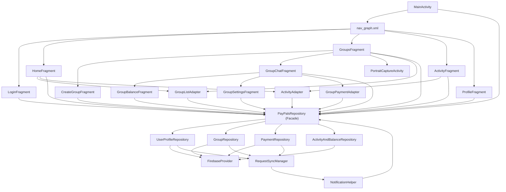

---
tags:
  - paypals
  - moc
  - architecture
aliases:
  - PayPals Project Overview
  - Home
---

# PayPals - Project Overview (MOC)

> [!abstract] Project Summary
> **PayPals** (`com.sdu.paypals`) is an Android group expense-splitting and payment-tracking application written in Kotlin using Material 3, ViewBinding, AndroidX Navigation, Firebase Authentication, Cloud Firestore (with persistent offline cache), and ZXing QR code scanning.

---

## System Architecture

---

## Vault Navigation & Map of Content

### Configuration, Infrastructure & Resources
- [[01 - Build, Config & CI-CD]] — Gradle build scripts, version catalog, ProGuard rules, `.gitignore`, Firebase config, `README.md`, and GitHub Actions APK release workflow.
- [[02 - Manifest, Navigation & Menus]] — `AndroidManifest.xml`, `nav_graph.xml`, `bottom_nav_menu.xml`, and `menu_main.xml`.
- [[03 - Layouts & Resources]] — All 15 XML layouts, values/themes/colors/dimens/strings, backup rules, drawables, and launcher/splash assets.

---

## Source Files by Layer

### 1. Activities & App Shell
- [[MainActivity]] — Single-activity host, splash screen, toolbar/bottom bar sync, connectivity & status banner, deep links, incoming nudge listener, tap-outside-to-unfocus.
- [[PortraitCaptureActivity]] — Portrait-locked ZXing capture activity for QR code scanning.

### 2. UI Screens (`Fragments`)
- [[LoginFragment]] — Firebase Auth login & signup with validation and automatic user profile sync.
- [[HomeFragment]] — Personalized greeting, total owed/owes dashboard card, top 3 groups, and latest 5 activities.
- [[GroupsFragment]] — Real-time group list, top-right QR scanner action, create-group FAB.
- [[CreateGroupFragment]] — New group creation form with name, description, and category icon chips.
- [[GroupChatFragment]] — Group payment timeline, interactive balance summary card, payment creation dialog, receipt review dialog, share payment, and unpaid member nudges.
- [[GroupBalanceFragment]] — Detailed breakdown of who owes the user, who the user owes, unpaid direct action buttons, and full group member balance list.
- [[GroupSettingsFragment]] — Group QR code generator, admin-only metadata/icon editing, email member lookup, admin promotion, leave/delete rules.
- [[ActivityFragment]] — Chronological user activity stream with search, Strategy-based category filters (`FilterMode`), sort cycling (`SortMode`), and 10/25 card limit toggle.
- [[ProfileFragment]] — User profile header, name/email/password editing with re-authentication, propagation across groups, and sign-out.

### 3. RecyclerView Adapters
- [[GroupListAdapter]] — Renders group summary cards (`item_group.xml`).
- [[GroupPaymentAdapter]] — Renders left/right payment chat bubbles with progress bar and actions (`item_payment_request.xml`).
- [[ActivityAdapter]] — Renders color-coded activity items and timestamp formatting (`item_activity.xml`).

### 4. Data Models
- [[GroupChat]] — `GroupIcon`, `GroupMember`, `GroupChat` Firestore serialization and admin/leave business rules.
- [[PaymentModels]] — `ParticipantStatus`, `PaymentLogEntry`, `PaymentRequest`, `NudgeNotification`, `ActivityCategory`, `UserActivityItem`, `MemberDebtItem`, and `UserBalanceSummary`.

### 5. Repository & Data Access Layer
- [[PayPalsRepository]] — **Facade Pattern** unifying all domain repositories and dollar amount formatting (`formatAmount`).
- [[FirebaseProvider]] — Shared Firebase Auth/Firestore setup (offline persistent cache) and **Composite Observer Pattern** (`observeQuery`, `observeDocument`, `observeUserGroupPayments`).
- [[UserProfileRepository]] — Auth identity helpers, sign-up validation, Firestore `users/{uid}` sync, profile propagation, and pending email invite claiming.
- [[GroupRepository]] — Real-time group listeners, QR payload encoding/parsing, group creation, member invites, admin assignment, leave/delete checks.
- [[PaymentRepository]] — Group payment creation/splitting, marking shares paid, nudging unpaid participants, and real-time nudge detection.
- [[ActivityAndBalanceRepository]] — Activity item mapping (`buildUserActivityItems`), per-group and multi-group owed/owes balance calculation.

### 6. Lifecycle State Preservation (`SavedStateHandle` ViewModels)
- [[LoginViewModel]] — Auth mode toggle & email/name drafts.
- [[CreateGroupViewModel]] — Group name, description & icon chip draft.
- [[GroupChatViewModel]] — Open "Request" / Pay Share dialog flags, drafts, and excluded members.
- [[ActivityFilterViewModel]] — Search query, Strategy filter/sort modes, and 10/25 limit.
- [[GroupSettingsViewModel]] — Unsaved group edits & member email drafts.
- [[ProfileViewModel]] — Unsaved profile name/email edits (password excluded).

### 7. Offline Sync, Notifications & UI Utilities
- [[RequestSyncManager]] — **Command / Retry Queue** providing fault tolerance, connectivity tracking, background retries, and live status events.
- [[PendingWriteQueue]] — Pure JVM-testable queue & transient-error classifier used by [[RequestSyncManager]].
- [[NotificationHelper]] — System notifications for incoming nudges and background retry completions.
- [[UiHelpers]] — **Decorator, Factory, Lifecycle & Mapping Helpers** (`bindSavedText`, `collectOnStarted`, `simpleDiffCallback`, `enableTapOutsideToUnfocus`, `showPayShareConfirmationDialog`, `openGroupChat`, snackbar helpers, icon chip resolution).

### 8. Report Diagrams & Tests
- [[reliability_diagrams]] — Mermaid architecture & process-death recovery diagrams for `implementation_report.typ`.
- [[ExampleUnitTest]] — JUnit 4 unit tests (14 tests) covering domain rules, `SavedStateHandle` process-death recovery, and `PendingWriteQueue` fault tolerance.
- [[ExampleInstrumentedTest]] — Android instrumented context verification test.

---

## Key Design Patterns Used
> [!info] Design Patterns Summary
> - **Facade Pattern**: [[PayPalsRepository]] exposes a single cohesive API to UI, adapters, notifications, and tests while delegating to internal domain repositories.
> - **Observer / Composite Pattern**: [[FirebaseProvider]] centralizes snapshot subscriptions (`observeQuery`, `observeDocument`, `observeUserGroupPayments`), cleanly consumed by [[GroupRepository]], [[PaymentRepository]], and [[ActivityAndBalanceRepository]]. [[RequestSyncManager]] notifies [[MainActivity]] of connectivity and request status events.
> - **Strategy Pattern**: [[ActivityFragment]] uses `FilterMode` predicates and `SortMode` comparators directly on enums.
> - **Decorator & Factory Patterns**: [[UiHelpers]] wraps `Window.Callback` for dialog tap-outside-to-unfocus and provides factories for `DiffUtil.ItemCallback` and share-payment confirmation dialogs.
> - **Model Factory Pattern**: [[GroupChat]] and [[PaymentModels]] define `fromDocument` / `fromMap` / `toMap` Firestore serializers alongside domain rules.
