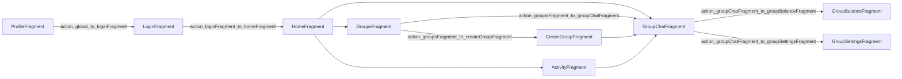

---
tags:
  - paypals
  - android
  - manifest
  - navigation
  - menu
aliases:
  - Manifest & Navigation
---

# AndroidManifest, Navigation Graph & Menus

> [!note] Navigation
> Back to [[00 - Overview]] | Related: [[03 - Layouts & Resources]] · [[MainActivity]] · [[PortraitCaptureActivity]]

---

## Navigation Flow Diagram

---

## AndroidManifest.xml
- **Path**: `app/src/main/AndroidManifest.xml`
- **Permissions & Hardware**:
  - `INTERNET`, `ACCESS_NETWORK_STATE` — used by Firebase SDKs and [[RequestSyncManager]].
  - `POST_NOTIFICATIONS` — requested at runtime in [[MainActivity]] and checked in [[NotificationHelper]].
  - `CAMERA` (and optional `android.hardware.camera`) — used by ZXing QR scanning launched from [[GroupsFragment]].
- **Application Attributes**: Uses `@mipmap/ic_launcher` / `@mipmap/ic_launcher_round`, hardware acceleration, `@xml/backup_rules` / `@xml/data_extraction_rules`, and base theme `Theme.PayPals` (see [[03 - Layouts & Resources]]).
- **Declared Activities**:
  1. [[MainActivity]] (`exported="true"`, theme `@style/Theme.PayPals.Starting` for Android 12+ SplashScreen, `windowSoftInputMode="adjustResize"`):
     - Launcher `MAIN`/`LAUNCHER` intent filter.
     - Deep-link `VIEW` intent filter matching `paypals://join` URIs built by [[GroupRepository]] / [[PayPalsRepository]].
  2. [[PortraitCaptureActivity]] (`screenOrientation="portrait"`, `theme="@style/zxing_CaptureTheme"`): Locks the ZXing barcode scanner strictly to portrait orientation.
  3. `com.journeyapps.barcodescanner.CaptureActivity` (`screenOrientation="portrait"` via `tools:replace`): Overrides library default orientation as fallback protection.

---

## nav_graph.xml
- **Path**: `app/src/main/res/navigation/nav_graph.xml`
- **Role**: Single-activity Navigation Component graph hosted inside [[03 - Layouts & Resources#content_main.xml|content_main.xml]] and dynamically configured in [[MainActivity]] (choosing `homeFragment` when authenticated or `loginFragment` otherwise).
- **Destinations & Actions**:
  - [[LoginFragment]] (`loginFragment`) -> `action_loginFragment_to_homeFragment` (pops login off back stack).
  - [[HomeFragment]] (`homeFragment`).
  - [[GroupsFragment]] (`groupsFragment`) -> `action_groupsFragment_to_groupChatFragment`, `action_groupsFragment_to_createGroupFragment`.
  - [[CreateGroupFragment]] (`createGroupFragment`).
  - [[GroupChatFragment]] (`groupChatFragment`, arg `groupId: String`) -> `action_groupChatFragment_to_groupSettingsFragment`, `action_groupChatFragment_to_groupBalanceFragment`.
  - [[GroupBalanceFragment]] (`groupBalanceFragment`, arg `groupId: String`).
  - [[GroupSettingsFragment]] (`groupSettingsFragment`, arg `groupId: String`).
  - [[ActivityFragment]] (`activityFragment`).
  - [[ProfileFragment]] (`profileFragment`).
  - Global action `action_global_to_loginFragment` (used by [[ProfileFragment]] on Sign Out to pop the entire graph).

---

## bottom_nav_menu.xml
- **Path**: `app/src/main/res/menu/bottom_nav_menu.xml`
- **Role**: Defines the 4 top-level tabs rendered by `BottomNavigationView` in [[03 - Layouts & Resources#content_main.xml|content_main.xml]] and synchronized by `syncBottomNavigationSelection` in [[MainActivity]]:
  - `@id/homeFragment` (`ic_home`, `@string/title_home`)
  - `@id/groupsFragment` (`ic_groups`, `@string/title_groups`)
  - `@id/activityFragment` (`ic_activity`, `@string/title_activity`)
  - `@id/profileFragment` (`ic_profile`, `@string/title_profile`)

---

## menu_main.xml
- **Path**: `app/src/main/res/menu/menu_main.xml`
- **Role**: Template options menu with `action_settings` (`never` action). In practice, fragment toolbar menus (Admin Settings in [[GroupChatFragment]] and Scan Group QR in [[GroupsFragment]]) are registered dynamically via AndroidX `MenuHost` / `MenuProvider`.
