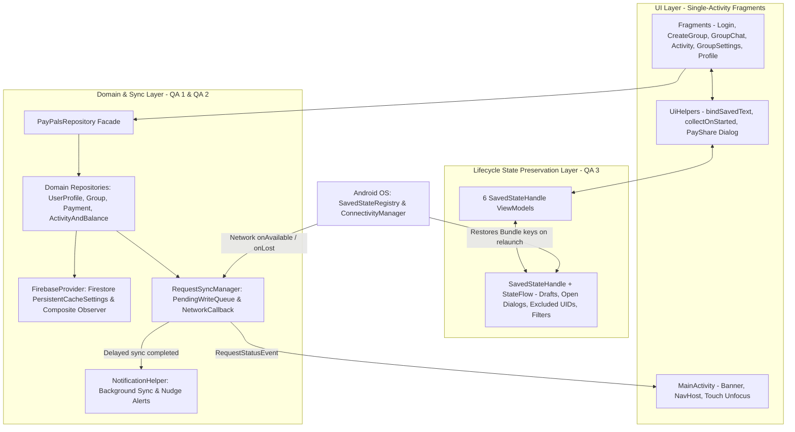
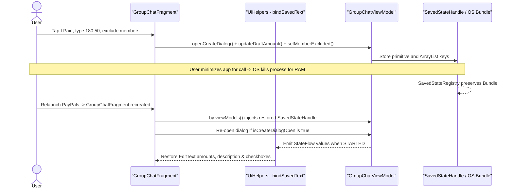

# PayPals Reliability QA Diagrams (Mermaid)

Use these two Mermaid diagrams when generating SVG/PNG figures for `docs/implementation_report.typ`.

## Diagram 1: Reliability Architecture (`reliability_architecture.svg`)

## Diagram 2: Process Death & Recovery Sequence (`lifecycle_recovery_sequence.svg`)

